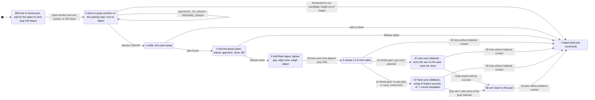
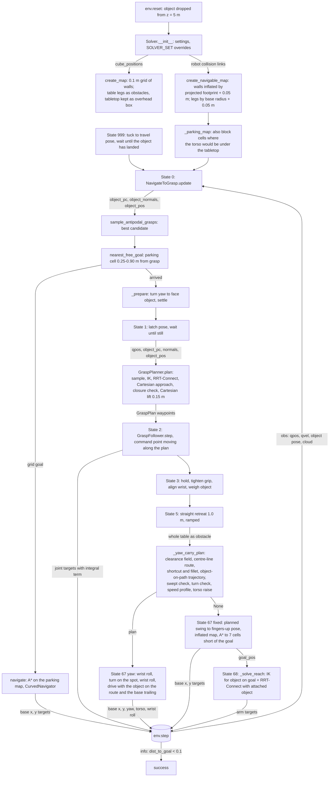

# Pick-Nav-Reach: the assignment and our solution

Preparation material for the written report. It explains the CS4278/CS5478
default course project and how our code solves it, with parameter values and
`file:line` references taken from the code on branch `fix/pick-nav-reach` at
commit `c24b00b`. Measured results come from the team notes
(`agents/handoff.md`, `agents/fixes.md`, `agents/slippage_by_object.md`) and
from the hand-back note of the yaw-carry work (`scratch/HANDBACK.md` in the
worktree that developed it; not committed). Where the notes and the code
disagree, this document follows the code and says so. Items that could not be
checked from the code or the measured results are marked **(unverified)**.

Contents

1. The assignment
2. System overview
3. Methodology, stage by stage
4. Code walkthrough: one call to `Solver.get_action`
5. Engineering and debugging method
6. Evaluation
7. Limitations and open questions
8. Glossary

---

## 1. The assignment

### 1.1 Task

A Fetch mobile manipulator in PyBullet must:

1. generate antipodal grasp proposals from the object's point cloud and
   surface normals, solve inverse kinematics (IK), and pick a YCB object up
   from a table;
2. carry the object through a randomly generated maze;
3. bring the object to the target position, shown as a green sphere
   (`readme.md:4-8`).

The course supplies the environment (`pick_nav_reach_env.py`). The team rule
is that the environment, the object state and all contact or dynamics
parameters stay unchanged. Our code is `solver.py` and the modules in
`custom_libraries/`. `pick_nav_reach_env_multi.py` is a copy of the
environment that adds a headless mode (`gui=False`, no real-time sleep) and a
per-run maze URDF path so that trials can run in parallel. Its physics
(gains, forces, substeps) is identical to the original; this was checked with
`diff`.

### 1.2 Scene

- **Robot.** Fetch, loaded with a fixed base at world (−2, 0, 0)
  (`pick_nav_reach_env_multi.py:94`). The base still moves, because base x, y
  and yaw are joints. All 15 joints start at 0.
- **Table** at the origin, rotated 90°. The tabletop is at about z = 0.626 m
  (measured, `handoff.md`).
- **Object.** One of 15 YCB objects, chosen by `object_idx` from the
  directories in `assets/ycb_objects/` in sorted order: 0 master chef can,
  1 sugar box, 2 tomato soup can, 3 mustard bottle, 4 potted meat can,
  5 banana, 6 strawberry, 7 apple, 8 bleach cleanser, 9 bowl, 10 mug,
  11 plate, 12 large marker, 13 hammer, 14 foam brick. `env.reset()` drops
  it from z = 5 m onto the table (`pick_nav_reach_env_multi.py:335`).
- **Maze.** A 12 × 16 grid of 1 m × 1 m × 2 m wall cubes, plus a 6-column
  room on the left that holds the robot and table
  (`pick_nav_reach_env_multi.py:182-227`). The seed picks the entrance and
  exit rows with `np.random.randint`. The maze generator itself is called
  with a fixed `seed=5`, so the layout varies through the entrance and exit
  positions.
- **Goal.** A visual-only sphere (radius 5 cm, no collision) at the maze exit:
  x = 17.5 m, y set by the exit row, z = 0.9 m
  (`pick_nav_reach_env_multi.py:162-180`).

### 1.3 Interface

`env.step(action)` takes a `numpy` array of shape (15,) and returns
`(obs, info)`.

**Action: 15 absolute joint position targets**, in `env.joint_indices` order:

| Index | Joint | Note |
|---|---|---|
| 0, 1 | base x, base y (prismatic) | world x = `qpos[0] − 2.0`, world y = `qpos[1]` |
| 2 | base yaw | |
| 3 | torso lift (prismatic) | 0 to about 0.386 m |
| 4, 5 | head pan, head tilt | not used by our solver |
| 6–12 | shoulder pan, shoulder lift, upper-arm roll, elbow flex, forearm roll, wrist flex, wrist roll | |
| 13, 14 | right and left finger (prismatic) | 0 to 0.05 m each (`fetch.urdf`) |

**Controller** (`pick_nav_reach_env_multi.py:254-330`):

- targets are unwrapped to the nearest equivalent angle for joints whose
  upper limit is the 314 rad sentinel, then clipped to the joint limits;
- PyBullet `POSITION_CONTROL` with position gain 0.3 on every joint except the
  fingers (0.03), no velocity gain, max force 2 × 10⁶;
- 5 physics substeps per `env.step` call at PyBullet's default 1/240 s
  timestep (not set explicitly), so one call is about 20.8 ms of simulated
  time.

The controller has no integral term. A joint under load (the arm under
gravity) settles short of its target. That one property explains several of
the bugs in section 5. A second property matters for carrying: each joint
moves 30 % of its remaining error per substep, so within one `env.step` a
joint's velocity goes 1, 0.7, 0.49, 0.34, 0.24 of its first-substep value and
then jumps back. A moving base or a turning wrist therefore gives the held
object a kick at the start of every step, growing with speed (`fixes.md` §21,
§32).

**Observation** (`_get_obs`, `pick_nav_reach_env_multi.py:365-379`):

| Key | Shape | Content |
|---|---|---|
| `qpos`, `qvel` | (15,) | joint positions and velocities |
| `object_pos`, `object_xyzw` | (3,), (4,) | object base pose (centre of mass) |
| `goal_pos` | (3,) | goal sphere centre |
| `object_pc`, `object_normals` | (1024, 3) | surface samples and outward face normals of the object mesh, moved to the current object pose |
| `cube_positions` | (N, 2) | xy centres of the maze wall cubes (140 in the readme example) |

**Info** (`evaluate`, `pick_nav_reach_env_multi.py:339-350`):
`dist_to_goal` = ‖object position − goal‖, and `success` = `dist_to_goal < 0.1`.

### 1.4 Rubric

The project is graded on 5 seeds we are not given: 5 test objects from the
provided set and 5 test mazes. The default tolerance is 10 cm
(`readme.md:67-119`).

| Part | Item | Points |
|---|---|---|
| **Pick (64 %)** | Function for grasp generation (from point cloud and normals) | 20 |
| | Function for motion planning | 20 |
| | Per trial: lift within 3000 sim steps | 6 |
| | Per trial: lift height ≥ 10 cm above the table | 6 |
| | Per trial: hold stable for ≥ 50 steps | 6 |
| | Per trial: final pose close to the target grasp | 6 |
| **Navigation and reach (36 %)** | Function for navigation | 20 |
| | Per trial: reach within 10 cm of the goal sphere | 6 |
| | Per trial: reach within 15000 sim steps | 6 |
| | Per trial: carry stability, no drop that needs a re-grasp | 4 |

The per-trial items are summed and then averaged over trials. They add up to
40 points per trial, and with the three 20-point function items the total is
100. The readme also says "2 pts each (max 8)" under carry stability; how that
fits with the 4-point line is unclear (section 7).

**The team's own step target.** The team works to a stricter target than the
rubric: the whole episode (pick, carry and reach) within 1,500 `env.step`
calls (`handoff.md`, Session 3 part 3; it was 3,000 before that). Current
deliveries take about 1,200–1,400 calls (section 6). How credit scales with
steps, whether the lift limit scales too, and which objects count are open
questions for the teaching staff.

---

## 2. System overview

### 2.1 File map

| File | Role |
|---|---|
| `solver.py` | `Solver`: the state machine called once per `env.step`; all settings in `__init__`, with `SOLVER_SET` overrides; occupancy and parking maps; base navigation; the yaw carry (`_yaw_carry_plan`, `_yaw_carry_step`, contact-force weighing `_held_weight` / `_adapt_to_weight`); the fixed carry and arm reach (`_tuck_with_object`, `reach_goal`, `_solve_reach`) |
| `custom_libraries/yaw_carry.py` | Geometry for the yaw carry, numpy/scipy only, no PyBullet: `ClearanceField`, `route_cells`, `shortcut`, `fillet`, `CarryTrajectory` (object-on-path trajectory, swept collision check, speed profile), `spin_clear`, `outline` |
| `custom_libraries/grasp.py` | `GraspConfig` (parameters); `sample_antipodal_grasps`; `_ManipulatorIK` (private IK model); `RRTConnect`; `GraspPlanner` (collision checking, Cartesian approach and lift, full plan); `GraspFollower` (runs the plan with a moving command point) |
| `custom_libraries/navigate_to_grasp.py` | `NavigateToGrasp`: picks a grasp, chooses a parking cell near the table, turns the base to face the object |
| `custom_libraries/a_star.py` | 8-connected grid A* |
| `custom_libraries/curved_navigator.py` | `CurvedNavigator`: rounds path corners with collision-checked Bézier curves and follows the result |
| `custom_libraries/wall_projection.py` | Projects every robot collision link onto the floor plane and inflates the maze walls by that footprint; its projection is also the robot outline used by the yaw carry |
| `tests/test_yaw_carry.py` | 5 `unittest` geometry tests of `yaw_carry.py` on an L-shaped corridor (no PyBullet) |
| `tests/test_grasp_srdf.py` | SRDF loading tests for the grasp planner |
| `tools/score.py`, `tools/batch.py`, `tools/phases.py` | Rubric scorer for one trial; parallel batch runner over a frozen copy of the repo; step breakdown by phase over a batch directory |
| `tools/trace_carry.py` | Per-step CSV trace of the carry (grip forces, drift of the object in the gripper, alignment) |
| `tools/run_one.py`, `tools/trace_hold.py`, `tools/trace_nav.py`, `tools/summarize_sweep.py` | Older single-run and tracing tools |

`custom_libraries/exit_transition.py` and `custom_libraries/recording.py` are
not used by the solver. `recording.py` is used only by the `__main__` block of
the environment to record videos.

### 2.2 Solver state machine

The episode is counted as delivered by the environment as soon as
`dist_to_goal < 0.1`. In the yaw carry this normally happens while driving,
because the route ends with the object on the goal (section 3.8); state 68 is
entered only if the route ends without success. In the fixed carry, state 68
plans and executes an arm reach. State 68 has no exit: after a successful
reach it holds the final arm pose; if three reach plans fail it holds the
current pose ("hold" phase). The fixed carry is entered either because
`carry_mode = "fixed"` or because `_yaw_carry_plan` returned `None` (side
grasp, no route, no swept-clear route variant or no clear turn on the spot).

### 2.3 One episode, with data flow

---

## 3. Methodology, stage by stage

Unless stated otherwise, parameter values come from `GraspConfig`
(`custom_libraries/grasp.py:56-129`) and `Solver.__init__`
(`solver.py:16-187`). Any `Solver` setting can be overridden without editing
code through the environment variable `SOLVER_SET`, for example
`SOLVER_SET="mass_adaptive=0"` or `"carry_mode=fixed,yaw_carry_speed=0.024"`
(numbers, booleans as 0/1, or strings). `Solver.__init__` reads it at its end
(`solver.py:179-187`), so it applies to every runner, including the course's
own demo loop; it was added for ablations (commit `5367609`).

### 3.1 Grasp generation: antipodal sampling with friction cones

`GraspPlanner.sample_antipodal_grasps` (`grasp.py:536-612`) uses only the
observed point cloud, the normals and the object's centre of mass
(`obs["object_pos"]`).

**Algorithm.**

1. Drop invalid points and normalise the normals. If there are more than
   `max_cloud_points` = 800 points, subsample 800 at random.
2. Form every point pair (i, j) with i < j. Keep pairs whose width w satisfies
   `min_width` (5 mm) ≤ w and w + `min_opening_clearance` (8 mm) ≤
   `closed_gap` + 2 × `finger_travel` (0.00285 + 2 × 0.05 = 0.10285 m), so
   w ≤ 94.85 mm (`grasp.py:562`). The finger travel is read from the URDF
   limits (`_validate_fingers`, `grasp.py:534`).
3. **Friction-cone test** (`grasp.py:565-569`). With d the unit vector from
   pᵢ to pⱼ and outward normals nᵢ, nⱼ, keep the pair when
   −nᵢ·d ≥ cos(atan μ) and nⱼ·d ≥ cos(atan μ). With μ =
   `friction_coefficient` = 0.5 the threshold is 1/√(1 + μ²) ≈ 0.894, a
   half-angle of about 26.6°. This is the standard condition for a two-finger
   antipodal grasp: the line joining the two contacts lies inside both
   friction cones, so squeezing along it can hold the object.
   Quality = min(−nᵢ·d, nⱼ·d).
4. **Centre-of-mass distance.** `com_dist` is the perpendicular distance from
   the centre of mass to the grasp line (`grasp.py:571-573`). Finger contacts
   have no spinning friction in this simulation, so a grasp line far from the
   centre of mass lets gravity turn the object about the grasp line (a pivot
   about the closing axis) and out of the fingers (`fixes.md` §12).
5. **Pre-ranking** of pairs by quality − 0.05·|d_z| − `com_weight` (4.0) ×
   `com_dist` (`grasp.py:576`).
6. **Gripper orientations** (`grasp.py:578-590`). The closing axis (gripper
   +Y) is ±d. The approach axis (gripper +X) is world "down" projected
   orthogonal to d, falling back to world x if d is vertical. It is then
   rolled about d by 0, ±30° and ±90°. Each pair gives up to 10 orientations
   (5 rolls × 2 closing directions).
7. **Obstruction test** (`grasp.py:591-600`). The whole cloud is transformed
   into the gripper frame. Points within the pad's extent (|x| ≤ 31.5 mm,
   |z| ≤ 12 mm) that lie just outside the contact span, between w/2 + 2 mm
   and w/2 + `opening_clearance`/2 + `finger_thickness` (12 + 15 mm), would
   be swept by the open fingers, so the candidate is rejected. Points further
   out, such as the far wall of a bowl, are ignored (`fixes.md` §7).
8. **De-duplication** on a key of centre rounded to 1 cm and approach and
   closing axes rounded to 0.2 (`grasp.py:602`).
9. **Final score** = quality + 0.10 × (−approach_z) − 4.0 × `com_dist`
   (`grasp.py:606`). The middle term favours top-down approaches. Sampling
   stops after 500 candidates (`num_samples`). The candidates are sorted and
   returned as (p1, p2, centre, quaternion, score).

**Grasp depth and TCP offset.** The gripper link origin is placed at
`grasp_pos = centre − R · tcp_offset` (`grasp.py:923`), where
`tcp_offset = (depth, 0, 0)` along the approach axis. `plan()` tries the
depths in `tcp_offsets = (0.010, 0.025)` in that order (`grasp.py:809-833`).
With the 63 mm pad, 0.010 puts the contact about 21 mm from the fingertip and
0.025 about 6.5 mm from it. The deep setting came in because objects slid
onto the tip edge during the lift (`fixes.md` §11). The shallow one is a
fallback for low objects where deep fingertips would hit the table.

**Finger openings for a candidate** (`grasp.py:905-915`), per finger:

- nominal contact = (w − `closed_gap`)/2;
- opened = nominal + `opening_clearance`/2 (12 mm), capped at the finger limit.
  The candidate is skipped if that leaves less than `min_opening_clearance`/2
  (4 mm);
- squeezed command = nominal − `squeeze`/2, with `squeeze` = 0.060, i.e.
  30 mm past contact per finger, floored at the 0 limit (`grasp.py:75, 913`).
  The motor target is inside the object, so the position controller presses
  with force. For objects narrower than about 63 mm the command is 0 (fingers
  commanded shut). Grip force is linear in how far the command sits inside
  the object, about 6.6 N per mm per finger; with this squeeze the object is
  held at about 250 N, 110–135 N for narrow objects, before the lift starts
  (`fixes.md` §22, §30). With the earlier 0.012 squeeze (about 50 N) heavy
  objects slid 10–28 mm in the fingers during the lift itself (commit
  `818e59b`).

### 3.2 Base placement (parking)

`NavigateToGrasp` (`navigate_to_grasp.py`) handles the mobile-base part of the
pick. It never runs IK. Defaults (`navigate_to_grasp.py:28-45`): horizontal
reach 0.25–0.90 m, preferred 0.55 m, grasp height in the base frame
0.20–1.30 m, |lateral| ≤ 0.60 m, arrival tolerance 0.06 m, yaw tolerance
0.05 rad, yaw step 0.02 rad per call, 5 settled calls.

1. `select_grasp` takes the top candidate from the sampler (`:110-136`).
2. `classify_reachability` (`:208-221`) is a coarse check. If the height is
   out of range, `update` raises `RuntimeError` and the solver goes to
   state 4.
3. `nearest_free_goal` (`:251-302`) does a breadth-first search of the free
   cells of the grid it is given (the parking map, below) reachable from the
   robot (8-connected, no cutting blocked corners). It keeps cells
   0.25–0.90 m from the grasp centre that clear the tabletop by the torso's
   forward reach plus 3 cm plus the arrival tolerance (`_overhead_clear`,
   `:106-108`), and picks the one minimising |d − 0.55| + 0.15 × travel
   distance.
4. The solver drives there (section 3.6). Then `_prepare` (`:304-345`) turns
   the yaw to face the grasp centre, holding x and y. It reports ready after
   5 consecutive calls with yaw error ≤ 0.05 rad, all joints still
   (|Δq| < 0.0005, |q̇| < 0.01) and base x, y within 1 cm of the snapshot. It
   raises after 600 calls.
5. If the object moves by more than 1 cm or 0.1 rad, the grasp and goal are
   re-selected (`:367-374`).

**Why the overhead check.** The travel map leaves out boxes whose lower
z ≥ 0.35 m (the tabletop, `solver.py:1491`), so the base can tuck under the
table. The torso cannot tuck under, and its front reaches about 8.8 cm ahead
of the base centre at tabletop height. `overhead_link_reach`
(`solver.py:1523-1544`) measures that reach from the collision geometry
(`fixes.md` §3).

**The parking map.** The overhead check above applies to the goal cell only.
A route planned on the travel map could still pass under the table, where the
torso jams against the edge: the bleach cleanser rolled to the far side of
the table, and the robot stayed in state 0 for the whole episode (commit
`4ad8305`). `_parking_map` (`solver.py:1365-1379`) therefore copies the
inflated travel map and also blocks every free cell whose centre is closer to
the tabletop rectangle than the torso reach + 3 cm. State 0 passes it both to
`NavigateToGrasp.update` and to the A* of the drive (`solver.py:252-258,
314`).

### 3.3 Inverse kinematics: a private fixed-base model

`_ManipulatorIK` (`grasp.py:282-381`):

- **Model.** The planner rewrites the Fetch URDF so that every joint other
  than the 8 manipulator joints (torso lift and the 7 arm joints) becomes a
  fixed joint at its currently measured value. Visual and collision elements
  are removed. The result is loaded with a fixed base at the robot's current
  base pose into a separate `p.DIRECT` physics client, so IK never disturbs
  the simulated robot.
- **Solver.** `p.calculateInverseKinematics` on `gripper_link` with joint
  limits, joint ranges, rest pose = current guess, damping 0.03, 160
  iterations, residual 10⁻⁵. Each restart refines 4 times, re-seeding from
  its own result (`:352-380`).
- **Restarts.** `ik_restarts` = 8 by default (12 for the goal reach, 1 per
  Cartesian step). The first starts from the given seed, the rest from
  uniform random configurations within the limits (`:353`).
- **Acceptance.** Position error ≤ 3 mm and orientation error ≤ 0.04 rad,
  checked by forward kinematics. A solution outside the limits is rejected,
  never clipped. Continuous roll joints are unwrapped to within ±π of the
  seed (`:370-372`).
- **Cross-check.** `_live_pose_ok` (`:757-765`) sets the solution on the real
  robot and confirms the same gripper pose, to catch a URDF mismatch.

### 3.4 Motion planning

`GraspPlanner._plan_once` (`grasp.py:835-1003`) plans the whole pick from the
measured parked state. The base stays fixed; only the torso, the arm and the
fingers move. The time budget is `planning_seconds` = 60 s of **process CPU
time** per depth attempt (`planning_clock = time.process_time`,
`grasp.py:148`). Planning costs wall time but no simulation steps.

**Collision checking** (`_valid`, `grasp.py:668-750`). A configuration is
valid when:

- every joint is within its limits. The measured start may overshoot by a
  small tolerance: 0.2 mm for the torso and 5 mm for the fingers
  (`measured_*_limit_tolerance`, `grasp.py:128-129`;
  `_configure_measured_limits`, `:629-661`). The finger allowance was 2 mm
  until commit `e57127d`: after the base turned to face the bleach cleanser an
  open finger was measured 2.08 mm past its limit and every plan was
  rejected;
- after the configuration is set with `resetJointState`, `getClosestPoints`
  with `collision_margin` = 2 mm finds nothing between a moving robot link
  and any other body (`:693-707`). The obstacle list is every body except the
  robot. Contacts on non-moving links (the parked base) are ignored. With
  `touch=True`, finger contact with the object is allowed up to
  `contact_penetration` = 6 mm, because the object's collision shape (a
  convex decomposition) is a few mm larger than the point cloud;
- no self-collision occurs among `self_pairs` (`:494-503`). These are all link
  pairs that include a moving link, minus pairs in the same fixed cluster,
  directly jointed pairs, and the 10 `disable_collisions` pairs in
  `assets/fetch/fetch.srdf` (validated against the URDF and the live robot,
  `_read_srdf_pairs` and `_validated_link_pairs`, `:155-193`). The pairs are
  checked one by one, skipping pairs whose bounding boxes are more than the
  margin + 1 cm apart (`:708-730`). This replaced one robot-against-robot
  query (about 20 ms, 95 % of a check): same answer on 400 of 400 random
  poses, 0.9 ms instead of 13 ms per check over 304 checked pairs (`fixes.md`
  §26);
- **with an attached object**: the object is moved to gripper pose × the grasp
  transform and checked against every other body (`:731-749`). Contacts with
  the table that existed at planning time (normal z > 0.7,
  `support_contacts`, `:888-894`) are tolerated only if they get no deeper.

All checks run inside `saveState`/`restoreState` (`_snapshot`, `:614-623`),
so the simulation is left exactly as it was. Checking is done at discrete
samples (`edge_samples`, `:196-200`): 0.025 rad per arm joint and 5 mm for
the torso.

**RRT-Connect** (`RRTConnect`, `grasp.py:203-279`). This is bidirectional
RRT with a greedy connect step. It works in a scaled joint space: the torso
is divided by `torso_metric_scale` = 0.20 m per radian-equivalent, so metres
and radians are comparable. Parameters: step 0.20, edge resolution 0.025, at
most 2500 iterations, goal bias 0.15 (sample the other tree's root), and
`rrt_seconds` = 8 CPU-s per candidate (raised from 1 s, because checking the
straight start-to-pregrasp edge alone took 1–2.5 CPU-s on a busy machine,
`fixes.md` §17). It first tries the straight edge. It returns a densified
path (every 0.025) whose edges are all collision-checked. Continuous joints
are bounded to ±π around the start, so a path never jumps across ±π.

**Per-candidate pipeline** (top `max_candidates` = 60 candidates, in score
order; the stage names below match the reject counters in `last_stats`):

1. **open**: move the fingers from their measured width to the opened width
   with the arm still, checked every 2 mm (`opening_fail`, `:916-921`);
2. **pregrasp IK**: gripper at `grasp_pos − 0.08 m × approach` (the
   `pregrasp_distance`) (`ik_fail`, `:923-934`);
3. **transit**: RRT-Connect from the current arm pose to the pregrasp, with
   the fingers open (`transit_fail`, `:940-958`);
4. **approach**: a Cartesian straight line to `grasp_pos` in 5 mm steps
   (`_cartesian`, `:767-807`). Each step is solved by IK seeded from the
   previous one, with at most 0.18 rad per arm joint and 2 cm of torso per
   step, and every interpolated sample is checked (`approach_fail`);
5. **closure**: close from opened to nominal in 1 mm steps with `touch=True`
   (`closure_fail`, `:967-972`). The squeeze beyond nominal is a force
   target, not a pose, so it is not collision-checked;
6. **lift**: a Cartesian line `lift_distance` straight up with the object
   attached (`lift_fail`, `:973-984`).

The result is a `GraspPlan` with full 15-joint waypoints labelled
open / transit / approach / close / lift (`:985-1000`). The fingers are at
the opened width during transit and approach, and at the squeezed command for
close and lift. The waypoints are clipped to the URDF limits.

**Lift height.** The plan lifts `lift_distance` = 0.15 m, and the follower
accepts the lift once the object has risen `min_lift_fraction` = 0.8 of that,
12 cm (`grasp.py:88-89, 1209`). The rubric needs 10 cm; the 5 cm margin
covers controller sag and the object settling in the fingers. Measured lifts
are 14.8–15.5 cm with at most 3 mm of sag over the 50-step hold, and the lift
item passes on every reference trial (`fixes.md` §18; commit `7b93fc6`: 10/10
reference trials, was 0/10 at 0.08 m).

### 3.5 Grasp execution

`GraspFollower.step` (`grasp.py:1071-1216`) is called once per `env.step` in
state 2. It follows the plan with a moving command point (a "carrot") instead
of converging on every densified waypoint (commit `ec66857`, `fixes.md` §25):

- **Carrot.** A command point moves along the planned joint-space polyline by
  one call's worth of motion, with one common factor across joints so it stays
  on each checked segment (`:1111-1129`). Speeds (`GraspConfig`, `:104-109`):
  0.04 rad per arm joint and 6 mm of torso per call in open and transit,
  0.01 rad and 3 mm in approach, close and lift. The speed ramps up over
  8 calls at the start of each phase (`:1110`).
- **Stops.** The carrot waits for the measured state only at phase ends and
  at corners of the joint-space path (direction cosine < 0.995,
  `:1034-1044`). Tolerances: 0.008 rad and 1 mm of torso at a phase end,
  0.02 rad (torso 4 mm) at a corner (`:1160-1168`). Between stops an
  equal-gain P controller following a point along a straight segment stays on
  it.
- **Integral term.** `integral += 0.05 × error`, clipped to ±0.15 and added to
  the torso and arm command (`:1139-1147`). While the carrot moves, only the
  error perpendicular to the path is integrated; integrating the along-path
  lag wound up and overshot each segment end. This cancels the gravity sag of
  the P-only controller (`fixes.md` §5).
- **Pinned joints.** Base and head are commanded to the planned values. If
  they drift more than 0.03, the follower fails (`:1092-1093`).
- **Object watch.** During open, transit and approach, the follower fails if
  the object moves more than 12 mm or rotates more than 0.10 rad from the
  planned pose (`:1094-1098`).
- **Fingers.** They get their target directly, so they open during the
  transit; the approach starts only once the total opening is within 4 mm of
  the plan (`:1149-1152, 1169-1173`). Gravity shifts both weak finger servos
  sideways by several mm, so a per-finger test never converged on some
  grasps.
- **Close.** The finger command ramps at 0.5 mm per call to the squeezed
  target (`:1153-1158`). The phase ends after 12 consecutive ticks of
  *bilateral contact* (both finger links touching the object with normal
  force > 0.01 N, `_contacts`, `:1050-1055`), or once the fingers have
  stopped moving for 12 ticks with both touching. The arm tolerance is not
  required here, because the squeezed object pushes back on the arm. Stalled
  fingers without contact fail after 60 ticks (`:1174-1194`).
- **Lift.** The follower fails after more than 20 ticks without bilateral
  contact. At the last waypoint it needs bilateral contact (a one-tick flicker
  waits rather than failing) and the object raised by at least 12 cm
  (`:1195-1212`).
- **Timeout.** 600 ticks per waypoint (`:1199-1200`).
- On success, `hold` = the last waypoint's target. State 3 commands this
  target **without** the integral term, so the arm may sag slightly during
  the hold.

With this follower and state 999 ending once the object has landed, the lift
completes at step 253–364 (median 297) on the 10 reference trials
(`fixes.md` §25), and 30–60 steps later after the squeeze was raised to 0.060
(commit `818e59b`). The yaw-carry batches give a median of about 340 steps to
the end of the lift (section 6.3).

### 3.6 Navigation: maps, A* and the curved navigator

These are used for the drive to the table and for the fixed carry. The yaw
carry plans its own route (section 3.8).

**Occupancy grid** (`create_map`, `solver.py:1315-1363`). The grid has 0.1 m
cells and covers the wall centres ± 0.5 m. Wall cubes are rasterised exactly.
Other bodies come from their link AABBs (`get_extra_obstacle_bounds`,
`:1447-1521`), excluding the robot, the object, the goal marker, the floor and
the merged maze body. For the drive to the table (`is_2d=True`), boxes with
lower z ≥ 0.35 m (the tabletop) are left out and recorded as overhead boxes.
For transport (`is_2d=False`, called on leaving state 5) the whole table is
an obstacle.

**Inflation** (`create_navigable_map`, `solver.py:1381-1415`):

- **Walls** are inflated by the robot's actual projected footprint.
  `robot_xy_polygons` (`wall_projection.py:93-154`) projects the collision
  geometry of every robot link at its current pose (meshes and box fingers)
  onto the floor plane as convex hulls. `footprint_offsets` (`:52-76`) turns
  them into grid offsets, padded by one cell plus a 0.05 m safety margin.
  `inflate_walls` (`:79-90`) marks every base cell that would put any part of
  the robot on a wall. Projection ignores height, which is conservative for
  2 m walls. The held object is **not** part of this footprint.
- **Table legs and other extras** are dilated by a square of radius
  ceil((base radius + 0.05)/0.1) cells. The base radius is measured from the
  base collision mesh vertices (`get_base_radius`, `:1184-1311`).

This navigation keeps the yaw fixed, so the footprint is only valid for the
arm pose it was measured in. The inflated map is rebuilt each time a travel
pose is reached (`navigate`, `solver.py:1061-1071`). Two arm poses are used:

- `travel_joint_targets` (`solver.py:106-115`), arm forward, for the drive to
  the table. The grasp planner starts from this pose. State 999 already
  moves the arm there while the object falls;
- `carry_joint_targets` (`solver.py:127-136`), used only by the fixed carry:
  gripper pointing straight up at about 1.6 m with every link within 0.289 m
  of the base centre, so the fixed-yaw inflation does not seal the maze's
  narrowest passage (the travel pose reaches 0.84 m forward, `fixes.md` §9,
  §21). Gravity takes any creep in the fingers into the palm.

**A\*** (`a_star.py:43-73`): 8-connected, cost 1 or √2, octile heuristic, no
diagonal moves past a blocked corner. Returns `[]` when there is no path.

**Curved navigator** (`CurvedNavigator`, `curved_navigator.py`):

- `build` (`:109-171`): route = current base position plus A* cell centres,
  with collinear points removed. Each corner is replaced by a quadratic Bézier
  whose entry and exit are `cut` = min(0.35 m, 40 % of each leg) from the
  corner. If the curve is not collision-free, `cut` is halved, up to 8 times.
  The curve is subdivided until the chord error is ≤ 2 mm, and every chord is
  checked against the inflated grid with that error as padding
  (`segment_free`, an exact segment-versus-cell test, `:53-91`).
- `step` (`:177-227`): progress is the projection of the *measured* base
  position onto the path, and it never moves backwards. The target is up to
  `max_lookahead` = 0.5 m ahead, halved (up to 12 times) until the straight
  line from the base deviates from the path by ≤ 2 cm and is collision-free.
  Status becomes `reached` within 3 cm of the end. If no acceptable target is
  found, the status is `blocked_or_off_path` and the step is zero.
- The base command is the measured position plus that step
  (`solver.py:1110-1140`).

### 3.7 Transport: the common start (hold, weigh, retreat)

Both carries share these steps.

1. **State 3, hold** (`solver.py:379-408`). The arm holds `follower.hold`.
   The finger command is tightened by a further 0.5 mm per tick, up to
   `carry_grip_extra` = 30 mm, floored at 0 (`:385-388`). With the 30 mm
   squeeze already in the plan, this ends with the fingers commanded shut for
   every width the sampler accepts. Meanwhile `_align_grip` (`:536-562`)
   turns the wrist roll at up to 0.1 rad per tick so that the closing axis
   lies along the retreat direction (modulo π): the per-step kick of the base
   is then taken as a normal force by the fingers, not by friction across the
   pads. The hold ends once at least `hold_before_transport` = 60 ticks have
   passed and the alignment factor exceeds 0.995, or after 200 ticks
   (`:402`).
2. **Weighing** (`mass_adaptive` = True; yaw carry only; `:405-406`). At the
   end of the hold, `_held_weight` (`:669-677`) sums the vertical components
   of the normal and friction forces of all robot–object contacts. While
   everything is still this equals the object's weight; it matched m·g within
   0.01 N on the soup can and foam brick (`fixes.md` §33). `_adapt_to_weight`
   (`:679-687`) computes the factor clip(`gentle_mass` / mass, `gentle_min`,
   1) with `gentle_mass` = 0.35 kg and `gentle_min` = 0.5, and multiplies
   `yaw_carry_speed`, `yaw_carry_accel`, `yaw_rate_limit`, `roll_rate_limit`
   and `carry_speed` by it; it also caps `object_turn_rate` at
   0.04 rad per tick × factor. Objects up to the soup can (0.32 kg) are
   unaffected. On a real robot this would correspond to force-sensing finger
   pads or a wrist force sensor. Whether reading contact forces from the
   simulator is acceptable is an open question (section 7), so it is a flag
   that can be ablated with `SOLVER_SET="mass_adaptive=0"`.
3. **State 5, retreat** (`:410-440`). Straight away from the object for
   `retreat_distance` = 1.0 m with the arm and fingers frozen, so the object
   clears the table before any arm or yaw motion. The base step comes from
   `_ramped_speed` (`:525-534`): at most `carry_speed` = 36 mm per tick
   commanded (the base covers about 83 % of a command per tick, so about
   30 mm actual), changing by at most `carry_accel` = 2 mm per tick², and
   low enough to stop at the goal. It takes 46 steps (section 6.3). Within
   3 cm of the goal the solver plans the yaw carry, or falls back to the
   fixed carry (`:417-439`).
4. **Drop detection** (`_check_holding`, `solver.py:189-203`). In states 5,
   67 and 68, 30 consecutive ticks without bilateral finger contact send the
   solver to state 4, and `grasp_error` records where. State 3 is not
   covered.

### 3.8 Transport: the yaw carry (default)

`carry_mode = "yaw"` (`solver.py:61-68`). The idea: do not move the arm at
all after the lift. The arm stays in its post-lift configuration (forward,
gripper pointing down, the object hanging below the fingers about 0.75–0.77 m
ahead of the base centre on every reference trial, `fixes.md` §31). Instead
the base turns to follow the route, with the object's centre riding on a
smooth corridor-centre path and the base trailing it at arm's length. The
route ends with the object on the goal, so no arm reach is needed. This
replaced a 250–330-step arm swing to the fingers-up pose, during or just after
which most objects of the fixed carry were lost (`fixes.md` §31).

**Planning** (`_yaw_carry_plan`, `solver.py:564-667`), once, at the end of
the retreat. Planning time costs no simulation steps.

1. **Gate.** The gripper's approach axis must point within about 26° of
   straight down (world z component < −0.9, `:591-593`); with the gripper
   vertical the wrist roll turns the closing axis about the vertical without
   moving anything else. Side grasps fall back to the fixed carry.
2. **Clearance field.** `create_map(env, False)` makes the whole table an
   obstacle. `ClearanceField` (`yaw_carry.py:34-65`) resamples walls ∪ table
   5 times finer (2 cm) and takes a Euclidean distance transform; looking up
   the fine cell and subtracting one fine-cell diagonal makes the value a
   lower bound on the true distance to the occupied squares. Points off the
   map have clearance 0.
3. **Swept footprint** (`solver.py:598-609`). The outline (points every 1 cm,
   `outline`, `yaw_carry.py:310-322`) of every robot collision link projected
   to the floor at the live pose (`robot_xy_polygons`), in the base frame,
   plus a ring of points around the gripper axis with radius = the farthest
   object point from that axis, at least 7 cm. The ring is the disc that the
   object and fingers sweep as the wrist turns (commit `a0ce16d`; 10 cm for
   the banana).
4. **Route** (`route_cells`, `yaw_carry.py:68-118`). A* over 0.1 m cells,
   8-connected, no corner cutting, over cells whose clearance is at least the
   base radius + 5 cm. Each move costs its length × (1 + 6 × max(0, 0.48 m −
   clearance)), so the route keeps to the centre line of the 1 m corridors and
   goes straight in the open.
5. **Smoothing.** `shortcut` (`yaw_carry.py:121-131`) greedily replaces runs
   of cells by line-of-sight segments that keep a given clearance. `fillet`
   (`:134-176`) replaces each corner by a circular arc tangent to both legs,
   as large as the radius limit allows, using at most half of each leg; if the
   arc violates the clearance its radius is halved, down to 5 cm, and the
   sharp corner is kept otherwise. The result is sampled every 1 cm. Four
   (clearance, radius) variants are tried in order: (0.40, 0.5 =
   `yaw_fillet_radius`), (0.40, 0.3), (0.45, 0.5), (0.36, 0.3) m
   (`solver.py:619`).
6. **Object-on-path trajectory** (`CarryTrajectory`, `yaw_carry.py:201-295`).
   The carried point is the object's centre, at offset (a, b) in the base
   frame, L = |(a, b)|. For every object position on the path, the base centre
   is the point of the same path at chord distance L behind it; the base yaw
   is the chord heading minus the bias atan2(b, a), so the object stays at its
   offset; and ψ, the path tangent at the object, is the object's direction of
   motion. Like a trailer, the base cuts inside every corner and the arm and
   object stay on the inside. Rejected alternatives: putting the base on the
   path with yaw along the tangent makes the 0.77 m arm stick out of every
   corner (17–26 samples within the 4 cm margin on seeds 42, 7, 1); no maze
   corner allows a full turn on the spot with an arm of 0.5 m or more
   (`fixes.md`, part 4, "Tried, not kept").
7. **Swept collision check** (`collisions`, `yaw_carry.py:249-259`). The
   footprint is placed at the base pose of every 1 cm object sample and must
   stay at least `yaw_carry_margin` = 4 cm from walls and table. A variant
   that fails is skipped (`solver.py:624-628`).
8. **Turn on the spot** (`spin_clear`, `yaw_carry.py:298-307`). The turn from
   the present yaw to the route's starting yaw is checked every 0.01 rad, the
   short way first, then the long way (`solver.py:629-634`). If no variant
   passes both checks, the plan returns `None` and the fixed carry runs.
9. **Speed profile** (`speed_profile`, `yaw_carry.py:261-290`). Per sample,
   the object speed is the smallest of: `yaw_carry_speed` = 30 mm per tick
   (the actual speed the fixed carry reached at 36 mm commanded); a base speed
   of 1.2 × that (36 mm); `yaw_rate_limit` = 0.05 rad per tick of base yaw;
   `roll_rate_limit` = 0.04 rad per tick of wrist roll; and
   `object_turn_rate` on the object's own heading (1e9, i.e. off), each
   converted to object speed through the trajectory's rate of change per
   metre; at least 2 mm per tick. A backward pass with
   `yaw_carry_accel` = 1.7 mm per tick² makes the speed fall in time for every
   later limit and to 0 at the end.
10. **Torso** (`solver.py:644-656`). The torso target puts the object's
    centre at `carry_object_height` = 0.90 m, the goal's height, within the
    torso limits; it is checked collision-free with the object attached
    (`_held_object_validity`, `:839-895`), otherwise the torso stays.
11. **Wrist model** (`:657-661`). With the gripper vertical, the closing-axis
    heading = base yaw + c0 + k × roll, with c0 and k read once from the live
    pose.

**Execution** (`_yaw_carry_step`, `solver.py:698-778`), once per tick in
state 67. The fingers keep the hold command and the torso moves toward its
target at 2 mm per tick. Phases:

1. **spin_roll** (only if `spin_roll` is True and the turn exceeds 0.15 rad):
   base still; the wrist rolls at ≤ 0.04 rad per tick until the closing axis
   is tangential to the coming turn (at right angles to the arm), within
   0.05 rad (`:726-731`).
2. **spin**: the base turns on the spot with a trapezoidal profile: the
   object speed v rises by the ramp, is at most 30 mm per tick and
   0.05 rad per tick × L, and falls in time to stop at the target yaw; each
   tick the yaw advances by v / L. The phase ends when the target is
   commanded and the measured yaw is within 0.02 rad (`:732-744`).
3. **drive_roll**: base still; the wrist rolls the closing axis onto the path
   tangent at the start (`:745-749`).
4. **drive** (`:750-768`): the carrot's arc length s advances by v per tick,
   with v ≤ previous v + ramp and ≤ the backward-pass profile. The base
   target is the trajectory pose (x, y, yaw) at s itself, so all three base
   joints lag by the same amount and the base stays on the path. The wrist
   tracks the path tangent (closing-axis alignment). The carrot waits (v = 0)
   while the base lags more than 0.10 m behind it or the wrist roll error
   exceeds 0.3 rad. Optional `slip_governor` (off by default): the object's
   position along the gripper x axis is compared with its value at the start
   of the drive, and the speed is cut for good to 60 % at 6 mm and 40 % at
   10 mm of slide toward the fingertips (`slip_slowdown`, `:754-759`). It made
   no measurable difference on the reference batch (section 6.2), so it is
   off.
5. **end**: once s is at the end of the route and the lag is under 2 cm. The
   route ends with the object over the goal at goal height, so the
   environment has normally declared success already. If not, the solver
   holds the base and enters state 68 straight in the "plan" phase
   (`:769-776`).

Measured phase lengths: about 40 steps for each wrist roll and 40 for the
turn, 119 in all, and about 715 for the drive (section 6.3). The wrist roll
rate was 0.1 rad per tick at first; with the base still that slid a banana
3 mm per tick out of the fingers (the angular kick grows with the rate), hence
0.04 (`fixes.md` §32).

**Fallback.** `_yaw_carry_plan` returns `None`, and the fixed carry runs
unchanged, when the gripper does not point down (side grasps), when no base
route exists, or when no route variant passes the swept check and the turn
check. The fallback path was tested by forcing it
(`SOLVER_SET="yaw_carry_margin=0.6"`: soup can delivered by the fixed carry
at 1,786 steps). On maze seeds 42, 7, 1, 2, 3 with the post-lift poses of
objects 2, 5, 6, 7, 14 every yaw trial planned a route (`handoff.md`,
part 4). In the heavy-object batch one potted meat can grasp was a side grasp
and fell back (HANDBACK, section c).

### 3.9 Transport fallback: the fixed carry and the goal reach

`carry_mode = "fixed"`, or the automatic fallback. This is the carry of
commit `e57127d`, unchanged.

1. **Swing** (`_tuck_with_object`, `solver.py:932-970`; `_plan_tuck`,
   `:897-930`). The arm moves to `carry_joint_targets` (fingers up) along a
   collision-checked path with the object attached: the straight joint-space
   edge if valid, else RRT-Connect (30 CPU-s); a straight joint move if no
   path is found. It is followed at `tuck_rate` = 0.012 rad per tick, torso
   2 mm per tick, with a common scale. The inflated map is then rebuilt for
   this footprint (`navigate`, `:1061-1071`).
2. **Drive** (`solver.py:486-523`). A* on the inflated map to the goal's
   cell; once a route exists the goal is replaced by the cell
   `reach_backoff_cells` = 7 before its end (`stop_short_of_goal`, commit
   `6a8e1f4`; before, the robot drove onto the goal cell and backed off
   again). The curved navigator's step is capped by `_ramped_speed` (36 mm per
   tick commanded, 2 mm per tick² ramp) × an alignment factor:
   `_align_grip` turns the wrist roll at 0.1 rad per tick to keep the closing
   axis along the direction of travel, the base waits while the error is above
   0.3 rad, and below that its speed scales with cos² of the error. The
   fingers are commanded to the hold value throughout.
3. **Reach** (state 68, `reach_goal`, `:780-837`). The backoff phase is now a
   no-op, since the carry already stopped 7 cells short. Then up to 3 plan
   attempts with `_solve_reach` (`:972-1054`), each with a 60 s CPU budget:
   - read the object's offset in the gripper frame and treat the object as
     attached;
   - obstacles = every body except the robot, the held object and the goal
     marker; no support contacts are allowed; the held object is not checked
     against the gripper links (it moves rigidly with them), only against the
     walls and the rest of the robot; the start is clipped to the joint limits
     (`_held_object_validity`, `:839-895`; `fixes.md` §19, §23);
   - candidate gripper orientations: the current one plus 9 variants (roll 0,
     ±π/2 × yaw 0, ±0.5), sorted by how little they turn the gripper from the
     current one; aim points: the goal centre, then 5 points 5 cm from it
     (−x, +z, ±y, −z). Orientation is the outer loop, so an off-centre aim in
     the current orientation beats a centred one that turns the gripper over
     (`fixes.md` §28);
   - pass 1: IK (12 restarts, at most 2 s) for a gripper pose that puts the
     **object** at goal + aim, for every candidate; the first with a valid,
     collision-free straight joint-space move wins. Pass 2: RRT-Connect (up to
     6 s each) with the object attached, nearest IK solution first
     (`fixes.md` §20).
4. **Arm**: follow the path with the base held, with per-tick limits of 2 mm
   (torso) and `reach_rate` = 0.012 rad (arm) on a common scale. Waypoint
   tolerance is 0.03 rad, 0.01 at the last. Then **hold**. If all three plan
   attempts fail, the robot holds its pose short of the goal.

---

## 4. Code walkthrough: one call to `Solver.get_action`

The evaluation loop (for example `tools/score.py`) calls
`action = solver.get_action(env)` and then `env.step(action)`, once per step.
`get_action` (`solver.py:206-523`) reads a fresh observation with
`env._get_obs()` and dispatches on `self.state`.

| Order | Code | What happens |
|---|---|---|
| construction | `Solver.__init__` (`solver.py:16-187`) | base radius from the collision mesh; settings (speeds, carry mode, yaw-carry limits, weighing); latch `travel_joint_targets` and `carry_joint_targets`; `create_map(env, True)` + `create_navigable_map()`; build `GraspPlanner` (loads SRDF, computes self-collision pairs), `CurvedNavigator`, `NavigateToGrasp`; give it the tabletop rectangle and the torso reach; `state = 999`, `wait = 200`; finally apply `SOLVER_SET` overrides (`:179-187`) |
| every call | `solver.py:207-209` | in states 5/67/68, `_check_holding` first. (The per-step printing of the state and of every robot contact was removed in `a70a4b7`.) |
| 999 | `solver.py:211-248` | `moving_pose` tucks the arm into the travel pose (and rebuilds the inflated map once it is there); the object's pose is recorded each call; leave for 0 once the object has stayed within 3 mm and turned < 0.05 rad over the last 15 calls and the arm is tucked, or after 200 calls. State 0 starts at step 62–160 instead of 200 (`fixes.md` §25) |
| 0 | `solver.py:250-318` | `navigate_grasp.update(obs, self._parking_map(), ...)` returns one of three decisions. `NAVIGATE_TO_GRASP`: `navigate(env, goal, parking map)` (`:1056-1140`) runs A* once per goal and calls `curved_nav.step` each tick. `PREPARE_GRASP`: return the alignment action. `GRASP`: latch `qpos` as `_grasp_hold_target`, go to 1. A `RuntimeError` leads to 4 |
| 1 | `solver.py:320-366` | command the latched pose; wait for 12 consecutive "settled" calls (object moved < 1 mm, max \|q̇\| < 0.05); then call `grasp_planner.plan(obs)` synchronously, inside this one call. If a plan is found, build a `GraspFollower` and go to 2, otherwise go to 4 |
| 2 | `solver.py:368-377` | `grasp_follower.step(obs)`; `done` leads to 3, `failed` to 4 |
| 3 | `solver.py:379-408` | command `follower.hold`; tighten the finger command by 0.5 mm per tick up to 30 mm; turn the wrist toward the retreat direction; after ≥ 60 calls and aligned (or > 200): set the retreat goal 1.0 m away along base minus object, weigh the object (yaw carry with `mass_adaptive`), go to 5 |
| 5 | `solver.py:410-440` | ramped base step toward the retreat goal; within 3 cm: in the yaw mode call `_yaw_carry_plan` (`:564-667`) and stay in 67 with that plan; if it returns `None` (or in the fixed mode) switch the travel targets to the carry pose, set `_tuck_rate`, `create_map(env, False)`; go to 67 |
| 67, yaw | `solver.py:483-484`, `_yaw_carry_step` `:698-778` | spin_roll, spin, drive_roll, drive, end (section 3.8); at the end without success go to 68 in the "plan" phase |
| 67, fixed | `solver.py:486-523` | `navigate(...)`: planned swing to the carry pose, rebuild the map, A*, set the stop cell 7 cells short; cap and ramp the base step, align the wrist; command the finger hold; when `curved_nav.status == "reached"`, go to 68 |
| 68 | `solver.py:480-481`, `reach_goal` `:780-837` | backoff (a no-op now), plan (`_solve_reach`), arm, hold |
| 4 | `solver.py:442-444` | return the last command, so the episode keeps running |

Planning in states 1, 5 (the yaw plan) and 68 blocks inside a single
`get_action` call, so it costs wall time but no simulation steps.

---

## 5. Engineering and debugging method

### 5.1 Making failures observable

- **Headless runners.** `tools/run_one.py` plays one episode (one object, one
  seed) and prints one `RESULT:{json}` line: states visited, final state,
  `grasp_error`, lift height and the planner's reject counters (`ik_fail`,
  `transit_fail`, `approach_fail`, `closure_fail`, …). That turns "it doesn't
  work" into "stuck in state X for reason Y" (`fixes.md`, "How it was
  debugged").
- **Tracing.** `tools/trace_carry.py` (commit `a139817`, extended through
  part 4) writes one CSV row per step while the object is carried: state,
  navigator status, base position and its per-step displacement (measured
  and commanded), the largest arm-joint velocity, per-finger force, bilateral
  contact, the drift of the object in the gripper frame (x toward the
  fingertips, y along the closing axis, z across the pads), contacts between
  the object and anything but the robot, the angle between the closing axis
  and the base's motion, base yaw, the yaw-carry phase, the angle between the
  closing axis and the gripper's own motion (`galign_deg`) and the gripper's
  step (`dgrip_mm`). It prints EVENT lines when a finger's grip force changes
  by more than 20 % within 5 steps, GRASP lines with the finger contacts and
  a weight check at the retreat, and a final RESULT line. It found the cause
  of the mid-maze drops (the per-step kick across the pads, `fixes.md` §21)
  and of the apple and banana losses in the yaw carry (§32, §34).
  `tools/trace_hold.py` and `tools/trace_nav.py` are the older tracers.
- **Ablations without code edits.** `SOLVER_SET="name=value,..."` overrides
  any `Solver` setting (section 3). `tools/score.py`, `tools/batch.py` (the
  variable is inherited by its trials) and `tools/trace_carry.py` all honour
  it, and since `5367609` `Solver.__init__` reads it itself.
- **Rubric scorer.** `tools/score.py` (section 6.1) prints one `SCORE:{json}`
  line per trial. `tools/batch.py OUT_DIR` runs objects × seeds in parallel
  (`--objects`, default 5 6 7 14 2; `--seeds`, default 42 7; `-j` jobs,
  default the CPU count; `--max-steps`, default 15000; `--repeat N`;
  `--report` re-prints the table of an existing directory) and prints a
  markdown table and per-item totals. `tools/phases.py OUT_DIR ...` prints the
  steps spent per phase (pick, hold, retreat, setup, carry, reach) per trial
  and as medians over delivered trials.
- **Frozen snapshots.** `batch.py` copies the working tree to `OUT_DIR/snap`
  before running, excluding `.git`, `.claude`, `pnr/`, caches, media,
  `paper_review`, `scratch` and `OUT_DIR` itself, and links `assets/` instead
  of copying 150 MB (`tools/batch.py:54-70`). Code edited during a batch
  therefore cannot mix versions. Each trial writes its own maze URDF, because
  parallel runs otherwise overwrite each other's.
- **Unit tests.** `tests/test_yaw_carry.py` checks the yaw-carry geometry
  without PyBullet: the clearance field is a lower bound (and 0 in walls and
  off the map), the route keeps to the corridor centre, the filleted path has
  1 cm steps, keeps 0.40 m clearance and has no sharp corner, the trajectory
  keeps the chord at 0.7 m with yaw from base to object and passes the swept
  check, a turn on the spot at the corner is correctly refused, and the speed
  profile ends at 0 and never exceeds 30 mm per tick.
- **Discipline.** Fix the earliest failure first, since each bug hid the next
  one. Change one thing at a time and re-run the whole reference set, so a fix
  for one object cannot silently break another. Judge by rates over pooled
  batches, because runs are not deterministic: identical code has given
  between 21 and 27 of 30 deliveries from batch to batch, so differences under
  about 5 in 30 are noise (`handoff.md`, part 4).

### 5.2 Main bugs found and fixed

From `fixes.md` (§1–34) and the commit log.

| # | Symptom | Cause | Fix |
|---|---|---|---|
| 1 | Every run timed out in state 0 | Alignment compared all 15 joints, fingers included, with a snapshot taken while they were moving | Compare only base x, y; other joints just have to be still |
| 2 | Start state already colliding with the table | Hold target re-set to *measured* qpos each tick; the P-only controller let the arm sag 28 cm onto the table | Latch the hold pose once on entering state 1 |
| 3 | Torso touching the table edge at parking | Parking map omits the tabletop so the base can tuck under it, but the torso cannot | Measure the torso's forward reach (0.088 m); require that plus margins from the table |
| 4 | Episode crashed in state 4 | State 4 returned `None` | Hold the last command |
| 5 | `approach_fail` on every plan | Gripper opened only 4 mm per side; 2 mm margin; collision hull fatter than the cloud; arm stalled 0.0085 rad short of the 0.008 threshold | `opening_clearance` 0.008 → 0.024, `contact_penetration` 0.0015 → 0.006, integral term in the follower |
| 6 | Wide objects lost all candidates | Larger opening no longer fitted | `min_opening_clearance` 0.008 fallback |
| 7 | Bowl and plate rim grasps rejected | Every point outside the contact span counted as an obstruction | Only points within opening clearance + finger thickness count |
| 8 | Crash on grasp-selection error | `RuntimeError` uncaught | Catch it and go to state 4 |
| 9 | A* never found a route | Travel pose 0.84 m forward + fixed-yaw footprint inflation sealed the bottleneck | Separate compact carry pose (≤ 0.29 m) |
| 10 | No transport after the pick | Not implemented | States 5 and 68, slow re-tuck, carry speed cap |
| 11 | Object slid onto the fingertip | Contact 6.5 mm from the tip | `tcp_offsets = (0.010, 0.025)`: deep first |
| 12 | Off-centre grasps pivoted out | No spinning friction | Rank by centre-of-mass distance (`com_weight` 4.0) |
| 13 | Creep during transport | Weak squeeze | `squeeze` 0.004 → 0.012 (later 0.060, #30) |
| 14 | Reach swung the object into corridor walls | Blind joint-space interpolation | RRT-Connect with the object attached, 5 cm aim offsets, 3 attempts |
| 15 | Robot drove on with an empty gripper | No drop check | 30 ticks without bilateral contact leads to state 4 |
| 16 | "No plan found" only in parallel or loaded runs | Planner deadlines in wall-clock time | Deadlines in process CPU time (`a7173ac`) |
| 17 | Plan failed, or fell through to a late, worse candidate | Checking the straight transit edge took 1–2.5 CPU-s; budget 1 s | `rrt_seconds` 1 → 8, `planning_seconds` 30 → 60 |
| 18 | Lift 8 cm, accepted at 4 cm; rubric wants 10 cm | Parameters | `lift_distance` 0.15, accepted at 0.8 of it (12 cm) |
| 19 | Soup can: reach never planned | Object crept to 0.3 mm from the palm, inside the 2 mm margin; held object checked against the gripper | Do not check the held object against the gripper links |
| 20 | Reach search failed 2 of 5 calls | One RRT used 6 s of the 20 s budget | IK for all candidates first, straight move first, then RRT nearest-first; 60 CPU-s |
| 21 | Mid-maze drops, about 3 in 10 | Per-step kick of the base ran across the 24 mm-tall pads (closing axis vertical) | Fingers-up carry pose, planned swing with the object attached, wrist roll keeps the closing axis along travel |
| 22 | Grip only 50 N | Force is linear in the command offset (6.6 N/mm) | `carry_grip_extra` 30 mm, ramped in during the hold |
| 23 | Every reach from the new carry pose failed ("joint_limit") | A joint held at a limit is measured a hair past it | `shoulder_lift` −1.20 off its limit; clip the start to the limits |
| 24 | Slow carry; a step-change start flung the apple | No speed ramp | `_ramped_speed` with `carry_accel`; speeds as settings (now 36 mm/tick, 2 mm/tick², `ee2fcae`) |
| 25 | Lift done only at step 1,035–1,267 | Per-waypoint convergence; fixed 200-step wait for the drop | Carrot follower; state 999 ends once the object has landed (lift at 253–364) |
| 26 | Self-collision check dominated planning | One robot-against-robot query, about 20 ms | Pair by pair, skipping pairs whose boxes are apart: 0.9 ms |
| 27 | Logs flooded | State and every contact printed each step | Removed |
| 28 | Objects lost in the final arm move | Candidate order turned the gripper over | Least gripper rotation first |
| 29 | Batch snapshots nested or filled the RAM-backed `/tmp` | `OUT_DIR` and `.claude` copied, assets copied | Skip them, link `assets/` (and skip `scratch/`, `96d3d72`) |
| 30 | Losses near the start of the carry; heavy objects slid in the lift | Lift ran at the planner's light (~50 N) squeeze | `squeeze` 0.012 → 0.060 (30 mm per finger past contact) |
| – | Bleach cleanser stuck in state 0 all episode (`4ad8305`) | Route to the parking cell passed under the tabletop; torso jammed | `_parking_map` blocks cells where the torso would be under the table |
| – | Bleach cleanser: every plan rejected (`e57127d`) | Open finger measured 2.08 mm past its limit after the base turn; 2 mm allowance | Measured finger overshoot tolerance 5 mm |
| 31 | 1,690–2,000 steps per delivery; 12 of 30 lost in the carry, mostly in or just after the arm swing | Swing to the fingers-up pose; fixed yaw | Yaw carry: no swing, base turns, object rides the route, no final reach |
| 32 | Banana slid out during the wrist roll | Angular kick per tick grows with the roll rate (0.1 rad/tick) | `roll_rate_limit` 0.04 |
| 33 | Heavy objects lost in the carry | Same speeds for every mass | `mass_adaptive`: weigh from contact forces, slow by 0.35 kg / mass (≥ 0.5) |
| 34 | Apples crept toward the fingertips (not fixed) | Creep under the per-tick kicks, gravity toward the tips | `slip_governor` tried; no measurable gain; off |

**Considered and rejected by team rule:** PyBullet's `frictionAnchor` on the
finger links removed the creep completely (0 mm in 1,500 ticks) but changes
the robot's contact model, so it is not used (`handoff.md`, session 2). The
same rule rules out `changeDynamics`, constraints and re-settling the object.

**Tried and not kept** (`fixes.md`, "Tried, not kept"): a finger hold relative
to the measured contact width (2/10 delivered); an orientation-controlled arm
swing and a gripper-down carry pose for the fixed carry (no pose fits the
footprint with room for the object); a slower arm swing (deliveries over
3,000 steps); in the yaw carry, the base on the path with yaw along the
tangent, turning on the spot at corners, retracting the arm, slower speeds for
light objects (no clear gain, 200–500 more steps), and no wrist roll around
the turn on the spot (inconclusive).

### 5.3 Development history (git)

The early commits (`2c1b54a` … `b73d428`) set up the environment, maze and
robot. Then came navigation out of the start area and first grasp attempts
(`b860d92`, `0ab796d`, `32c0350`: "failed grasp, backoff not enough so gripper
still within table frame"), and the SRDF test (`ac3da6a`). Debugging work on
this branch: `8207192` (grasp start state, grasp planning, maze transport and
reach), `ebc11a8` (deeper grasp, centre-of-mass ranking), `dbc8248` (planned
goal reach, drop detection), `9b62bd7` (`trace_hold.py`), `3514757`
(`score.py`, `batch.py`) and `a7173ac` (CPU-time budgets).

Since `a7173ac`, in four groups:

- **Scoring, lift and planning budgets** (Session 3): larger transit and
  search budgets (`ec604ba`), the 15 cm lift (`7b93fc6`), three goal-reach
  fixes (`6e5ca76`, `b8caf19`, `380d21a`), and `trace_carry.py` (`a139817`).
  Reference batch 5/10 → 7/10 delivered.
- **A 3,000-step episode** (part 2): less printing (`a70a4b7`), the fast
  self-collision check (`f5b81f3`), the fingers-up carry with wrist
  alignment and tight grip (`61e2151`), the carrot follower and the early end
  of state 999 (`ec66857`, `fc56bf5`), carry and arm speeds (`2db7f27`,
  `897a4b2`), batch snapshot fixes (`a71f790`, `82c09fd`, `beec9b4`) and the
  reach order (`84202b1`): 8/10 delivered at 2,712–3,028 steps.
- **Toward 1,500 steps** (part 3): the 30 mm squeeze (`818e59b`), carry at
  36 mm per tick with a 2 mm per tick² ramp (`ee2fcae`: 8/10 at
  1,712–1,970), stopping 7 cells short (`6a8e1f4`), and the two bleach
  cleanser fixes, the parking map (`4ad8305`) and the 5 mm finger tolerance
  (`e57127d`).
- **The yaw carry** (part 4): tracing support (`b5bb3f6`), the yaw carry
  (`f92cd63`), its geometry tests (`fe171ac`), scorer and phase tools
  (`0bf0095`, `d940cec`, `11e7f37`), the 0.04 rad per tick wrist roll and
  extra options (`04f5717`), weighing heavy objects and the slip governor
  (`5a2b1a3`), the swept disc of the turning object (`a0ce16d`), slip-governor
  trials ending with it off (`2de85ec`, `cb606b9`, `63bad91`, `2879bb7`),
  `scratch/` out of snapshots (`96d3d72`), `SOLVER_SET` read by the solver
  itself (`5367609`), and the notes (`6c05a0c`, `c24b00b`).

---

## 6. Evaluation

### 6.1 How `tools/score.py` measures each rubric item

One trial = one object × one seed, headless. A "step" is one `env.step` call
(the working assumption; see section 7). The run stops at the first success,
50 steps after a drop, on state 4, on a stall (no joint moved > 0.1 mm for 400
steps after the lift), or at 15,000 steps (`tools/score.py:24-26, 142-154`).

| Rubric item (points) | Scorer's measurement |
|---|---|
| Lift within 3000 steps (6) | step at which the solver enters state 3 (grasp and lift done) is ≤ 3000 |
| Lift ≥ 10 cm (6) | the **minimum** object height over the 50 steps after state 3, relative to the object's height when the grasp was planned, is ≥ 10 cm. This approximates "above the table" by "above its resting height" |
| Hold ≥ 50 steps (6) | bilateral finger contact on every one of the 51 checks from state 3 entry to +50, and the object still > 2 cm above rest at the end |
| Final pose close to target grasp (6) | after the 50-step hold, the planned grasp centre (fixed in the object frame at planning time) is within `POSE_TOL` = 0.10 m of the actual contact point (gripper pose + TCP offset). Needs hold_50. The angle error is reported but not scored. The 10 cm tolerance is the rubric's default tolerance and is lenient; the measured error is reported too |
| Reach within 10 cm (6) | `info["dist_to_goal"] < 0.10` on some step |
| Within 15000 steps (6) | the first success step ≤ 15000 |
| No drop (4) | the object was lifted and there was never a run of ≥ 30 steps without bilateral contact after the lift |

Maximum 40 points per trial. The three 20-point "function" items are not
scored by the tool, nor is the team's 1,500-step target; delivery steps are
reported and compared with it separately. The `SCORE` line also records the
state sequence with the yaw-carry sub-phases as `67:spin_roll`, `67:spin`,
`67:drive_roll`, `67:drive`, which carry ran (`carry`: yaw or fixed), the
weighing factor (`gentle`) and the planner's reject counters
(`tools/score.py:98-103, 166-185`). `tools/phases.py` turns the state
sequence into the step breakdown of section 6.3.

### 6.2 Current results: reference objects

Reference set: banana (5), strawberry (6), apple (7), foam brick (14), tomato
soup can (2). Delivered = within 10 cm of the goal; "steps" = the delivery
step (`env.step` calls). Sources: `handoff.md`, Session 3 part 4, and
HANDBACK sections a, b and "final4_std".

| Carry | Code | Seeds | Trials | Delivered | Delivery steps (median) |
|---|---|---|---|---|---|
| fixed yaw (before) | `e57127d` (two batches, one from an extracted copy of the commit) | 42, 7 | 30 | 18 (60 %) | 1,674–1,924 (1,806) |
| base yaw, slip governor off | `f92cd63` (30), `04f5717` (30), `2879bb7` (30) | 42, 7 | 90 | 75 (83 %) | 1,171–1,388 (about 1,250), all ≤ 1,500 |
| base yaw, slip governor on | `2de85ec` (30), `cb606b9` (30, milder 75 % / 60 %), `63bad91` (30) | 42, 7 | 90 | 71 (79 %) | 1,224–2,165; 8 over 1,500 |
| fixed (`SOLVER_SET="carry_mode=fixed"`) | `04f5717` | 1, 2, 3 | 15 | 12 | 1,670–1,905 (1,744) |
| base yaw | `04f5717` | 1, 2, 3 | 15 | 12 | 1,196–1,374 (1,262) |
| base yaw, independent re-run of the final code | `6c05a0c` | 42, 7, 1, 2, 3, twice each | 50 | 37 (74 %) | 1,198–1,380 |

- The yaw carry delivers more often on seeds 42 and 7 (83 % against 60 %) and
  about 550 steps sooner (median about 1,250 against 1,806). On seeds 1, 2, 3
  both delivered 12 of 15, the yaw carry about 480 steps sooner.
- Every yaw-carry delivery with the governor off is within the team's
  1,500-step target. With the governor on, slowed trials took up to 2,165
  steps for no gain, so it is off.
- Independent re-run, per object: soup can 10/10, strawberry 9/10, foam
  brick 9/10, apple 6/10, banana 3/10. All 50 trials passed the lift, 10 cm,
  hold and grasp-pose items; the 13 failures were all drops in the carry
  (state 67); mean 35.8/40 points per trial (batch table for `6c05a0c`). The
  last batch of the agent's own runs (`2879bb7`, 30 trials) lifted 29 of 30
  and delivered soup can 5/6, banana 4/6, strawberry 5/6, apple 4/6, foam
  brick 6/6.
- **Variation.** Identical code delivers between 21 and 27 of 30 from batch to
  batch, so differences under about 5 in 30 are noise. Single trials are not
  repeatable; the figures above are rates over pooled batches, and the
  independent re-run (74 %) is below the agent's pooled 83 %, within that
  spread on a different seed mix.
- Rubric points per item and mean points per trial are not summarised in the
  notes for the agent's batches.

Earlier milestones on the 10-trial reference batch (seeds 42, 7), for the
history: 5/10 delivered, 25.4/40 at `a7173ac` (lifts 7.8–8.3 cm, so 0/10 on
the 10 cm item); 7/10, 35.2/40 after fixes 17–20; 8/10, 36.8/40 at
`84202b1` (2,712–3,028 steps); 8/10, 36.8/40 at `ee2fcae` (1,712–1,970);
14/20, 35.2/40 at `6a8e1f4` (1,691–1,907) (`fixes.md`, commit messages).

### 6.3 Where the steps go

Medians over delivered trials, from `tools/phases.py` (`handoff.md`, part 4;
yaw column from batches like `final_std`, HANDBACK section b):

| Phase | Fixed yaw | Base yaw |
|---|---|---|
| pick (to the end of the lift) | about 312 | about 340 |
| hold | 60 | 60 |
| retreat | 46 | 46 |
| setup (wrist roll 40, turn on the spot 40, wrist roll 40) | – | 119 |
| arm swing + maze / drive | about 1,094 | about 715 |
| reach | about 278 | 0 (the object is driven onto the goal) |

The yaw carry saves the arm swing (250–330 steps) and the reach (about 280)
and spends about 120 on the setup. The remaining candidates for saving steps
are the setup (a curved start combining retreat and turn) and the 60-step
hold, which could overlap the retreat (`handoff.md`, part 4, "Next").

Under the alternative reading of "sim step" as physics substeps (5 per
call), the median lift at about 340 calls is about 1,700 substeps and the
deliveries at 1,171–1,388 calls are about 5,900–6,900 substeps, inside the
rubric's 3,000 and 15,000 either way (derived here from the figures above).

### 6.4 Failure analysis: where drops happen now

Yaw carry (`handoff.md`, part 4; HANDBACK section b):

- **Mostly in the drive.** The apple creeps toward the fingertips (downward,
  since the gripper points down) over hundreds of steps and goes suddenly at
  20–23 mm of slide. Its finger contact normals are the pad normals, so this
  is creep under the per-tick kicks, not the object being squeezed out
  (`fixes.md` §34). In some apple grasps it does not move at all.
- **The banana** is lost suddenly after corners or during the wrist rolls and
  the turn on the spot: rotations of a long object about the vertical.
- **In the setup**: a few banana and strawberry losses, in the wrist rolls or
  the turn.
- **In the retreat**: a few, in code shared by both carries (bad grasps).
- **Pick**: occasional failures before the carry (one strawberry trial in
  state 4 on the pick side at `2879bb7`).

Fixed carry, for comparison: 12 of the 30 baseline trials were lost in
state 67, most during or just after the swing to the fingers-up pose
(`fixes.md` §31).

### 6.5 All 15 objects

**All-objects run with the fixed carry** (objects 0–14 × seeds 42 and 7,
30 traced trials; frozen code with the fingers-up carry, full-force squeeze
and 36 mm per tick, i.e. `ee2fcae`; `agents/slippage_by_object.md`):
7 of 30 delivered.

| Outcome | Trials |
|---|---|
| Delivered (7) | foam brick ×2, soup can ×2, banana s42, strawberry s7, apple s42 |
| Lost in the carry or retreat (9) | sugar box ×2, hammer ×2 (in the arm swing), potted meat can s42, banana s7 (retreat), strawberry s42, apple s7 (mid-maze) |
| Grasp failed (1) | potted meat can s7 ("the object did not rise") |
| Never grasped (14) | mustard bottle and large marker (no plan: IK and approach failures); master chef can (state 4 at step 68 on s42, "No plan found" on s7); bowl and plate ("No antipodal grasp candidates found"); mug (on the floor after `env.reset()`, height out of range); bleach cleanser (never left state 0) |

**Since then.** The bleach cleanser is now picked (lift at about 570–610
steps) thanks to the parking map and the 5 mm finger tolerance (commits
`4ad8305`, `e57127d`: lifted and held 4/4, 0 before). Heavy objects are still
mostly lost in the carry (HANDBACK section c; seeds 42 and 7, **2 trials per
cell**, so these are indications, not rates):

| Object | Fixed carry (`5a2b1a3`, `carry_mode=fixed`) | Yaw, full speed (`04f5717`) | Yaw, weighed and slowed (`5a2b1a3`) | Yaw, gentle everywhere (`04f5717` + uncommitted turn-rate parameter) |
|---|---|---|---|---|
| sugar box (1) | 0/2 | 0/2 | 0/2 (lost in the drive) | 0/2 |
| hammer (13) | 0/2 (retreat, carry) | 0/2 | 1/2 (1,252 steps; weighs in under 0.35 kg, so full speed) | 0/2 (one lost in the retreat) |
| potted meat can (4) | 1/2 (1,959) | 0/2 (one fell back to the fixed carry, one plan failed) | 0/2 (one lost in the retreat; one side grasp, fell back, lost) | not run |
| bleach cleanser (8) | 0/2 | 0/2 | 1/2 (2,263; the other: "Object moved" before the grasp) | 2/2 (2,216, 2,414) |

"Gentle everywhere" used `yaw_carry_speed` 0.015, `roll_rate_limit` 0.02,
`yaw_rate_limit` 0.02, `object_turn_rate` 0.02, `carry_speed` 0.018,
`yaw_carry_accel` 0.001. Traces show the sugar box sliding during every
rotation about the vertical (9 mm across the pad in the first wrist roll, 17
after the turn, 21 after the second roll, lost about 126 ticks into the
drive), so rotations rather than translation loosen it; the hammer is lost in
the retreat, before any yaw-carry motion (HANDBACK section c).

---

## 7. Limitations and open questions

- **What is a "sim step"?** The working assumption, used by the scorer and by
  the team's 1,500-step target, is one `env.step` call. Each call is
  5 physics substeps. Delivered trials now meet the rubric's 3,000-step lift
  and 15,000-step reach under either reading (section 6.3); only the
  1,500-step target depends on it. Being confirmed with the teaching team.
- **Step-target questions.** How credit scales with steps, whether the lift
  limit scales too, and which objects count are open (`handoff.md`, part 3).
- **Carry stability points.** The readme says 4 points and also "2 pts each
  (max 8)". The scorer awards 4 per trial for no drop. To clarify.
- **Success is a rate, not a guarantee.** Runs with the same object and seed
  do not always give the same result, and identical code has delivered 21 to
  27 of 30 from batch to batch. All results are rates over seeds and repeats.
  The source of the run-to-run variation has not been pinned down
  **(unverified)**.
- **Verified mazes.** The yaw carry was verified only on the mazes of seeds
  42, 7, 1, 2 and 3, with the post-lift poses of objects 2, 5, 6, 7, 14; a
  route that passed the swept check was found on all of them. The test seeds
  are unknown; on another maze the yaw plan may fail and the fixed carry run.
- **The swept check ignores tracking error.** It uses the floor projection of
  each collision link's convex hull (height ignored, which is conservative
  for 2 m walls), the swept disc of the object and fingers, and a 4 cm margin,
  but does not model how far the real base deviates from the trajectory; the
  carrot only waits once the lag exceeds 10 cm. No wall contact was seen in
  the traces, but contacts were not logged systematically.
- **Reading contact forces.** `mass_adaptive` weighs the held object from the
  simulator's finger contact forces. A real robot would need force-sensing
  pads or a wrist force sensor. Whether this is acceptable is the same open
  question as reading the object's mass from the simulator; it is a flag,
  on by default, that can be ablated with `SOLVER_SET="mass_adaptive=0"`
  (light objects up to 0.35 kg are unaffected either way).
- **Objects not handled** (sections 6.4, 6.5):
  - bowl and plate: no antipodal pair fits; they need a specialised rim
    grasp;
  - master chef can: 102–103 mm across, while the fingers open to at most
    102.85 mm, so it fits with under 1 cm (in fact under 1 mm) to spare; the
    sampler requires 8 mm of clearance (w ≤ 94.85 mm), so only off-centre
    chords remain, and planning fails on IK and approach;
  - mug: lands on the floor at `env.reset()`; it would need a pick from the
    floor (the grasp height range is 0.20–1.30 m in the base frame);
  - mustard bottle and large marker: no grasp plan (IK and approach
    failures) in the all-objects run;
  - heavy objects (sugar box, hammer, potted meat can, bleach cleanser) are
    picked but mostly lost in the carry; the sugar box needs more than a
    slower carry, the hammer is lost in the shared retreat;
  - among the reference objects, the banana and the apple are the weak ones
    (sections 6.2, 6.4).
- **Side grasps** use the fixed carry, which was tested only by forcing it.
- **Single parking attempt.** After a failed plan the solver goes to state 4.
  `mark_goal_failed` exists in `NavigateToGrasp` but is never called, and
  state 1 has no timeout.
- **Navigation failure modes.** In the fixed carry, if A* finds no route,
  `navigate` raises `PlanningError`, which `get_action` does not catch in
  state 67, so the episode would crash; if the curved navigator reports
  `blocked_or_off_path`, it returns zero steps forever, with no replan or
  timeout. In the yaw carry, the carrot waits while the base lags more than
  10 cm or the wrist is more than 0.3 rad off, with no timeout either. (From
  reading the code, not observed.)
- **The fixed carry's footprint ignores the held object**, so a long object
  can brush a wall, and it is only valid for the arm pose and fixed yaw it was
  measured at. The yaw carry's swept check includes the object.
- **The state 3 hold has no integral term or drop check.** A loss during the
  hold goes unnoticed until state 5.
- **Collision checking is discrete** (0.025 rad / 5 mm samples, 2 mm margin;
  1 cm and 0.01 rad samples in the yaw-carry checks), not continuous, and the
  robot can deviate from the checked path under dynamics.
- **Friction assumption.** The planner assumes μ = 0.5. `handoff.md` reports
  that fingers and objects are both 0.5 and Bullet multiplies them, which
  gives 0.25 **(unverified here, from the notes)**. The friction cones used
  for sampling may therefore be too wide.
- **Seed coupling.** The seed is set before the object's surface points are
  sampled with `trimesh` and before the maze entrance and exit rows are drawn
  (`pick_nav_reach_env_multi.py:82-90, 158, 191-192`). If `trimesh` draws
  from NumPy's global generator, the maze for a given seed may depend on the
  object too. `run_batch.py` has a comment to that effect **(unverified)**.

---

## 8. Glossary

- **Antipodal grasp.** A two-finger grasp whose contact points have roughly
  opposite surface normals, so squeezing along the line between them pushes
  into the object on both sides.
- **Friction cone.** The set of contact force directions that do not slip
  under Coulomb friction μ: within atan(μ) of the inward normal. A grasp line
  inside both contacts' cones can be held by squeezing alone.
- **Grasp line / closing axis.** The line through the two contacts, along
  which the fingers close (gripper +Y in our convention).
- **Approach axis.** The direction the gripper moves in to reach the grasp
  (gripper +X), along the palm normal.
- **Pivot about the closing axis.** Rotation of the held object about the
  grasp line, like a door on a hinge through the two contacts. The simulated
  finger contacts have no spinning (torsional) friction, so gravity or a kick
  acting on an off-centre object can turn it about that line and out of the
  fingers.
- **TCP offset.** The offset from the gripper link frame to the tool centre
  point, here the intended contact centre on the pads. Choosing it sets how
  deep the object sits between the fingers.
- **Pregrasp.** A pose 8 cm back along the approach axis, from which the
  gripper moves straight in.
- **Cartesian path.** A straight line of the gripper in task space, turned
  into joint space by IK at small steps.
- **IK (inverse kinematics).** Finding joint values that put the gripper at a
  given pose.
- **Configuration space / joint space.** The space of joint values (here 8-D:
  torso + 7 arm joints) in which motion planning happens.
- **RRT-Connect.** A sampling-based motion planner that grows two random
  trees, one from the start and one from the goal, and repeatedly tries to
  connect them greedily. It is fast for single queries but gives no proof that
  no path exists when it fails.
- **SRDF.** Semantic Robot Description Format. Here it lists link pairs that
  can never collide or always touch, which are excluded from self-collision
  checks.
- **Attached object.** The held object, modelled as rigidly fixed to the
  gripper during planning so it is collision-checked with the arm.
- **Carrot.** A command point that moves along a planned path at a set speed;
  the controller tracks it, instead of converging on every waypoint. Used by
  the grasp follower and by the yaw carry's drive.
- **Occupancy grid / inflation.** A 2-D grid of blocked cells. Inflating it
  by the robot's footprint lets the planner treat the robot as a point.
- **Parking map.** The travel map with the cells blocked where the torso
  would be under the tabletop; used for the drive to the grasp position.
- **Clearance field.** For every point of the floor, a lower bound on the
  distance to the nearest wall or table cell (a distance transform).
- **A\*.** Best-first graph search with an admissible heuristic (here octile
  distance) that returns a shortest grid path.
- **Fillet.** A circular arc that replaces a sharp corner of a path, tangent
  to both legs.
- **Yaw carry.** Our default transport: the arm stays in its post-lift pose,
  the object's centre follows a smooth path and the base trails it at arm's
  length, turning its yaw to keep the object on the path, like a trailer.
- **Fixed carry.** The fallback transport: the base keeps one yaw, the arm
  swings the object into a fingers-up pose and reaches to the goal at the end.
- **Swept footprint.** The set of floor points covered by the robot and the
  held object as they move along the trajectory, here checked as the robot's
  projected outline plus the disc swept by the turning object, placed at every
  1 cm of the route.
- **Turn on the spot.** A base rotation with x and y held, here at the start
  of the yaw carry to face the route.
- **Closing-axis alignment.** Turning the wrist roll so the closing axis lies
  along the object's direction of motion. The per-step kick then acts as a
  normal force on the fingers instead of having to be resisted by friction
  across the pads.
- **Speed profile (backward pass).** The largest speed at each point of a
  path under per-step limits, computed from the end backwards so that the
  robot always slows in time for a later limit.
- **Per-step kick.** The velocity sawtooth that the environment's position
  controller gives every moving joint within one `env.step`, jerking a held
  object once per step.
- **Contact-force weighing.** Estimating the held object's mass from the sum
  of the vertical contact forces the fingers exert on it while still.
- **Bilateral contact.** Both finger links touching the object with positive
  normal force: our test for "still holding".
- **Integral term.** Accumulated tracking error added to the command, to
  remove the steady offset a P-only controller leaves under gravity.
- **Friction creep.** Slow sliding of a held object, because Bullet solves
  friction at the velocity level and does not hold a static grip exactly.
- **Step.** One `env.step` call = 5 physics substeps of 1/240 s.
